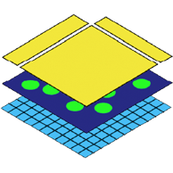

# {.heading-icon} SpatialData specifications

SpatialData is a data framework, a schema and a serialization format for uni- and multi-modal spatial omics datasets. It is supported by a growing suite of software libraries for performant access, manipulation and analysis in multiple languages, including Python, R and JavaScript.

This site specifies SpatialData independently of any implementation, so that all implementations
read and write the same datasets and agree on what they mean.

::::{grid} 1 1 3 3
:gutter: 3

:::{grid-item-card} Abstract data model
:link: spec/specification.html?impl=model
:link-type: url
:class-card: sd-shadow-sm

What a SpatialData dataset is: elements, coordinate systems, instances and annotation tables, in
plain language.
:::

:::{grid-item-card} & storage format
:link: spec/specification.html?impl=storage
:link-type: url
:class-card: sd-shadow-sm

How a dataset is stored: Zarr and Parquet, built on OME-NGFF. Normative and language agnostic.
:::

:::{grid-item-card} & in-memory formats
:link: spec/specification.html?impl=python
:link-type: url
:class-card: sd-shadow-sm

How each implementation represents the data model in memory. Not yet documented.
:::

::::

(reading-the-specification)=
## Reading the specification

The specification page describes each part of the abstract data model in plain language. Below
each part, the implementations specify how they represent it; choose the view in the navigation.

- In the implementation parts, the key words **MUST**, **MUST NOT**, **SHOULD**, **SHOULD NOT**
  and **MAY** are to be interpreted as described in
  [RFC 2119](https://www.rfc-editor.org/rfc/rfc2119). The data model uses no key words.
- Boxes labelled *Implementation note* are not normative; they help with understanding and
  implementing. Boxes labelled *Divergence from NGFF* flag places where a valid SpatialData store
  is not a valid NGFF 0.4 or 0.5 store.

## Implementations

- `spatialdata`: Python implementation ([repository](https://github.com/scverse/spatialdata),
  [documentation](https://spatialdata.scverse.org)).
- `spatialdataR`: R implementation ([repository](https://github.com/HelenaLC/spatialdataR)).
- `SpatialData.js`: JavaScript/TypeScript implementation
  ([repository](https://github.com/Taylor-CCB-Group/SpatialData.js)).

## Versions

The storage format is versioned by the container format: `spatialdata-container-format-0.2` is
current, `spatialdata-container-format-0.1` is deprecated, and `spatialdata-container-format-0.3`
is a draft that collects accepted changes. Where versions differ, the specification shows them in
tabs. How element formats, Zarr, OME-Zarr and `spatialdata` releases relate is in the
{doc}`version history and compatibility matrix <spec/storage-format/versions>`; changes not yet assigned
to a version are collected in {doc}`spec/storage-format/next`.

## Status and contributing

The specification is being extracted from the `spatialdata` design document and code base and
describes the format as written by `spatialdata` 0.6 to 0.8. Changes are proposed in GitHub issues,
ideally with a pull request; large features and breaking changes come with an {doc}`RFC <rfcs>`. See
{doc}`contributing_to_the_spec`.

To cite SpatialData, please see our
[publication](https://doi.org/10.1038/s41592-024-02212-x).

```{toctree}
:hidden: true
:maxdepth: 2

spec/specification
spec/storage-format/versions
spec/storage-format/ngff-compatibility
spec/storage-format/next
rfcs
glossary
contributing_to_the_spec
contributing
changelog
```
