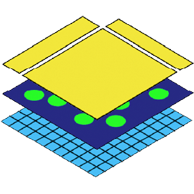

# {.heading-icon} SpatialData specifications

SpatialData is a data framework, a schema and a serialization format for uni- and multi-modal spatial omics datasets. It is supported by a growing suite of software libraries for performant access, manipulation and analysis in multiple languages, including Python, R and JavaScript.

This site specifies SpatialData independently of any implementation, so that all implementations
read and write the same datasets and agree on what they mean.

::::{grid} 1 1 2 2
:gutter: 3

:::{grid-item-card} Abstract data model
:link: data-model
:link-type: doc
:class-card: sd-shadow-sm

What a SpatialData dataset is: elements, coordinate systems, instances and annotation tables, in
plain language.
:::

:::{grid-item-card} Storage format
:link: storage-format
:link-type: doc
:class-card: sd-shadow-sm

How a dataset is stored: Zarr and Parquet, built on OME-NGFF. Normative and language agnostic.
:::

::::

## Status and contributing

The specification is being extracted from the `spatialdata` design document and code base and
describes the format as written by `spatialdata` 0.6 to 0.8. Changes are proposed in GitHub issues,
ideally with a pull request; large features and breaking changes come with an {doc}`RFC <rfcs>`. See
{doc}`contributing`.

To cite SpatialData, please see our
[publication](https://doi.org/10.1038/s41592-024-02212-x).

```{toctree}
:hidden: true
:maxdepth: 2

data-model
storage-format
ngff-compatibility
next
rfcs
contributing
CHANGELOG
```
